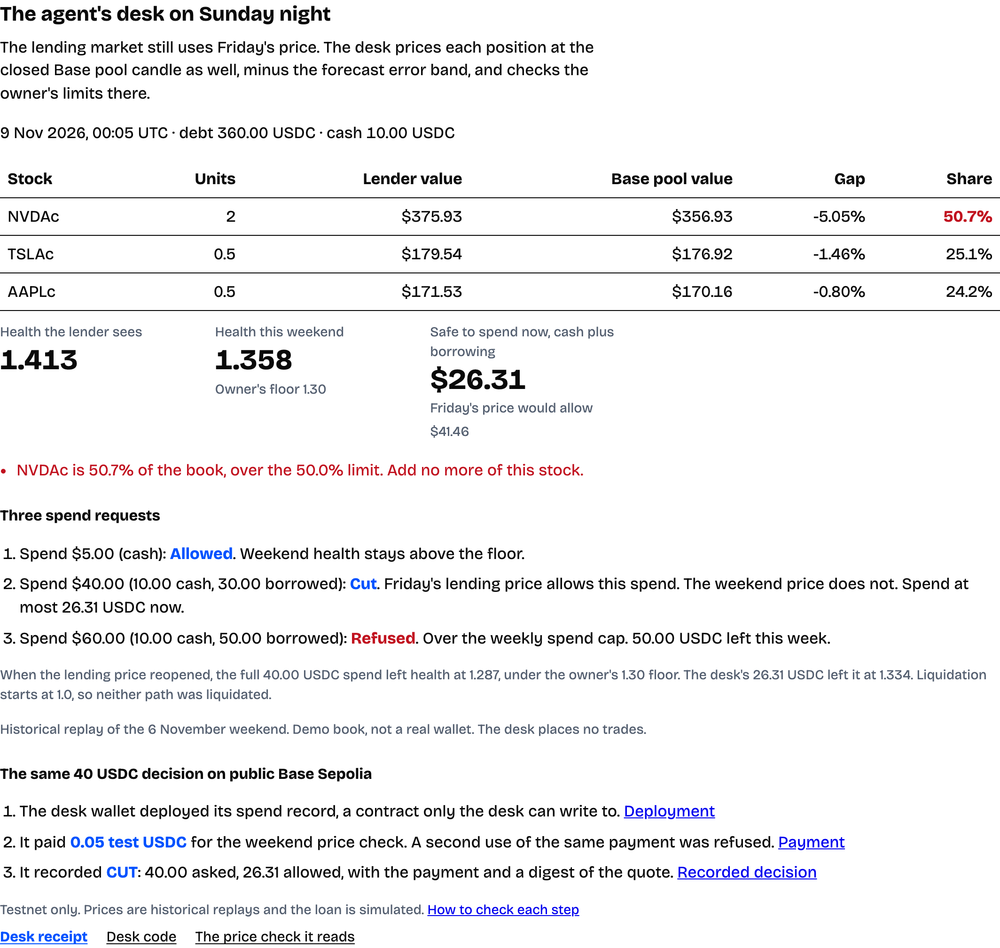
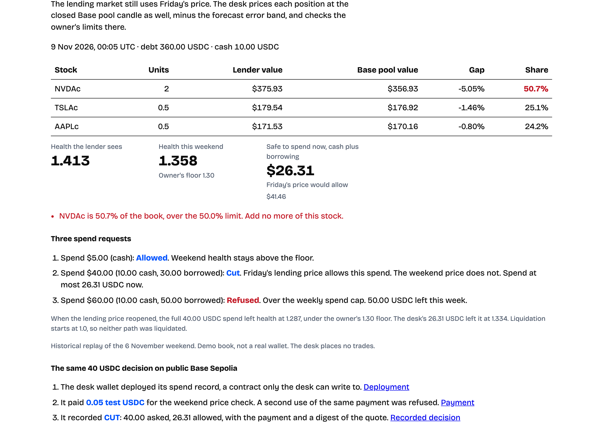
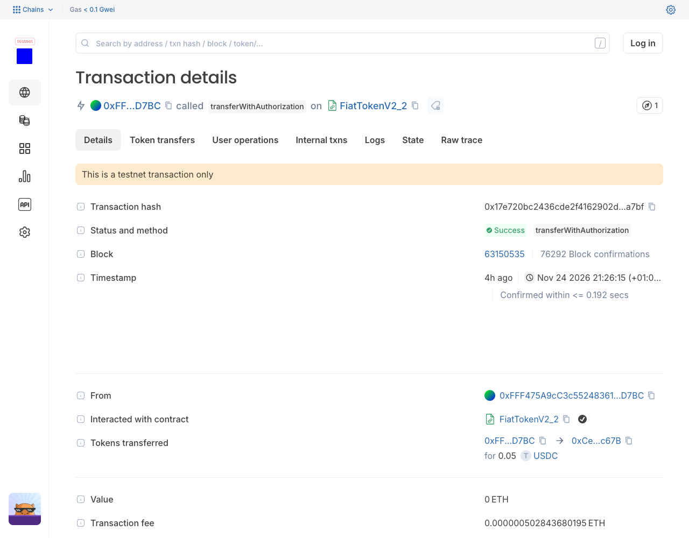
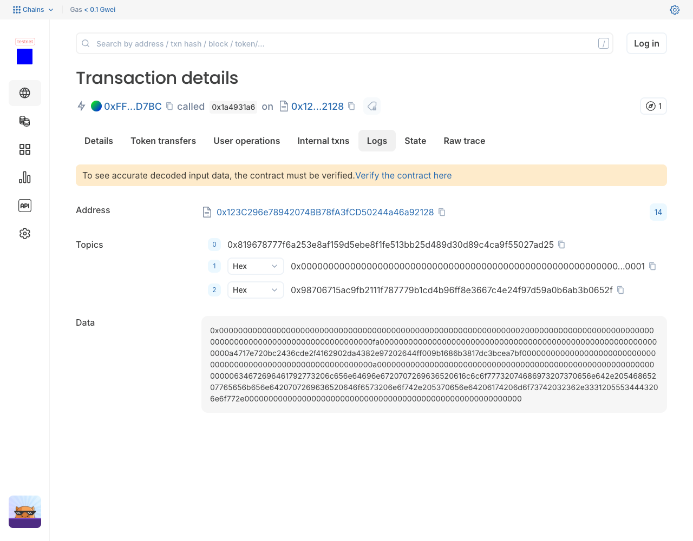

# Stock Desk for agents

An agent that keeps its savings in tokenized stocks on Base, and borrows USDC against them to pay for its work, asks the desk before every spend. The desk shows positions, exposure per stock and health in two views: the frozen lending price the lender uses over the weekend, and the closed Base pool price minus the forecast error band. A spend uses cash first and borrows the rest. The desk allows it, cuts it to the safe amount, or refuses it. It never buys or sells stock.

## Try the desk

```sh
python3 -B proof/run_desk.py                 # print the desk receipt for the saved 6 November weekend
python3 -B proof/run_desk.py --serve 8851    # GET /desk and /desk/spend?usd=25 on loopback
```

On the saved weekend the lender view shows health 1.413 and the weekend view 1.358 against an owner floor of 1.30. The agent holds 10 USDC cash. A 40 USDC spend passes on Friday's price and is cut to 26.31 USDC on the weekend price. When the feed reopened, the full spend would have left health at 1.287, under the floor, and the cut amount left it at 1.334. Liquidation starts at 1.0, so neither path was liquidated. The book and the 40 USDC amount were chosen by us to show the case. On these recorded prices the floor breaks at reopen only for spends above about 36.15 USDC, while Friday's price allows up to 41.46 USDC, so the example sits in a window of about 5 USDC. It is one recorded weekend. The book is a demo book, not a real wallet, and the prices are historical replays. The [desk receipt](demo/desk.json) is the captured run and [desk.py](proof/collateral_card/desk.py) is the code. Tests: `cd tests && python3 -B -m unittest test_desk`.

## Judge walkthrough: from the agent's request to the explorer

Five steps, about five minutes. Steps 1 and 2 run on your machine. Steps 3 to 5 are on public Base Sepolia (chain id 84532) and need only a browser. Every command below was run on 25 November 2026 and the output shown is the real output.

**1. The agent asks before it spends.** It is Sunday 9 November 2026, 00:05 UTC. The agent wants to spend 40 USDC on a report.

```sh
python3 -B proof/run_desk.py --serve 8851
curl -s "http://127.0.0.1:8851/desk/spend?usd=40"
```

```json
{"amount_usd": "40.00", "from_cash_usd": "10.00", "borrow_usd": "30.00",
 "lender_would_allow": true,
 "health_now": {"lender_view": "1.413", "weekend_view": "1.358", "floor": "1.30"},
 "action": "CUT", "allowed_usd": "26.31",
 "reason": "Friday's lending price allows this spend. The weekend price does not. Spend at most 26.31 USDC now.",
 "health_after": "1.300"}
```

The lender would say yes. The desk says spend at most 26.31.



**2. The desk pays for the weekend price it used.** The price check is an x402 endpoint. The first request gets HTTP 402. The desk signs a 0.05 test USDC authorization, retries and gets the dated quote with HTTP 200. Sending the same authorization again gets 402 with "authorization already used". These three HTTP answers happened on this machine and are saved in the [public run receipt](demo/public-sepolia.json) under `paid_check`. Only the payment itself is on chain (step 4).

**3. The spend record exists on Base Sepolia.** The desk wallet deployed `StockDeskLog`, a contract that only the desk wallet can write to. It records decisions and never trades.

- Desk wallet: [0xFFF4...D7BC](https://base-sepolia.blockscout.com/address/0xFFF475A9cC3c552483612D2699DE26114F8DD7BC). This is a fresh testnet-only key with three transactions, the three below.
- [Contract deployment](https://base-sepolia.blockscout.com/tx/0x432a35d82a008b510d21a2586bca0faa1cfc0574c11ab7f2b746c3ee898ab385) of [StockDeskLog at 0x123c...2128](https://base-sepolia.blockscout.com/address/0x123c296e78942074bb78fa3fcd50244a46a92128). Source: [contracts/StockDeskLog.sol](contracts/StockDeskLog.sol).



**4. The payment is on chain.** [Test USDC payment](https://base-sepolia.blockscout.com/tx/0x17e720bc2436cde2f4162902da4382e97202644ff009b1686b3817dc3bcea7bf): the desk wallet sends exactly 0.05 Circle test USDC (`0x036C...CF7e`) to the price-check seller `0xCed7...c67B` through `transferWithAuthorization`. The repeat refusal in step 2 can be checked at the token contract: the authorization nonce is marked used.

```sh
cast call 0x036CbD53842c5426634e7929541eC2318f3dCF7e "authorizationState(address,bytes32)(bool)" \
  0xFFF475A9cC3c552483612D2699DE26114F8DD7BC 0x2cda6e2d9f32484e38b1b4e70c5968f882376142050336b7d656cba98aaaa439 \
  --rpc-url https://sepolia.base.org
# true
```



**5. The decision is on chain.** [Recorded spend decision](https://base-sepolia.blockscout.com/tx/0xccbaea0f7e4c435a83d0ef4afadf6f6023c8c9b233f0dc686dbebf4418766f49): one `SpendDecision` event. The contract source is not verified on Blockscout yet, so the explorer shows the event data as raw words. Decode it with Foundry:

```sh
DATA=$(cast receipt 0xccbaea0f7e4c435a83d0ef4afadf6f6023c8c9b233f0dc686dbebf4418766f49 logs --rpc-url https://sepolia.base.org | jq -r '.[0].data')
cast decode-abi --input "f(uint8,uint256,uint256,bytes32,string)" "$DATA"
# 2                      action: 1 ALLOW, 2 CUT, 3 REFUSE
# 4000                   asked, in cents
# 2631                   allowed, in cents
# 0x17e720bc...a7bf      the payment transaction from step 4
# "Friday's lending price allows this spend. The weekend price does not. Spend at most 26.31 USDC now."
```

The event's second topic, `0x98706715...652f`, is the sha3-256 digest of the full decision and quote. The receipt publishes the exact text that was hashed, so anyone can recompute it:

```sh
python3 -c 'import json,hashlib; r=json.load(open("demo/public-sepolia.json")); print("0x"+hashlib.sha3_256(r["record_preimage"].encode()).hexdigest()==r["record_digest_sha3_256"])'
# True
```



**What is real and what is replayed.** Real: the desk code, the three Base Sepolia transactions, the test USDC payment and the recorded decision. Replayed: the prices (Base mainnet observations from the 6 November weekend) and the agent's book (a demo book). The loan is simulated, because Base Sepolia has no lender or stock token at the addresses the replay uses. To rerun the public flow on a local copy of Base Sepolia with no funds: `python3 -B proof/run_public.py --rehearse --out /tmp/desk-rehearsal.json` (needs Foundry).

The loan rule underneath is Collateral Card, described below.

# Collateral Card

A stock-backed loan can look healthy while its lending oracle still shows Friday's price. Collateral Card watches the weekend gap and tests whether simulated x402 payment proceeds can reduce debt before the oracle updates.

## Verify offline

From this folder, run the complete offline check with Python 3.10 or later.

```sh
python3 -B proof/verify_judge.py
```

The command rebuilds the forecast from the retained oracle rounds and DEX candles, verifies the recorded rule outcomes, and checks the two saved loan replay receipts against the recorded comparison. The [source manifest](proof/SOURCE-MANIFEST.md) explains the collection and the in-sample error band. The [receipt guide](proof/README.md) explains the separate fork evidence.

**Open the [public demo](https://morkeeth.github.io/collateral-card-demo/).** The demo requires no wallet or account. Built for Base Stocks Maxxing, Agentic Stock Finance track.

## Try the paid price check

A buyer gets the last frozen NVDAc Aave price and the closed Base pool candle with their UTC timestamps and percentage gap. To reproduce the HTTP challenge, Circle test USDC settlement and repeat-payment refusal on a disposable Base Sepolia fork, install Foundry with `anvil` and `cast` on your PATH and run:

```sh
python3 -B proof/run_sepolia.py --out /tmp/collateral-paid-quote.json
```

The fork uses public read-only Base Sepolia RPC and local development accounts. The prices are historical Base mainnet observations. [Fork run receipt](demo/paid-quote.json)

On public Base Sepolia, the desk settled a 0.05 test USDC price check, refused the repeat payment, and recorded a decision to cut a simulated $40.00 spend to $26.31. [Contract deployment](https://base-sepolia.blockscout.com/tx/0x432a35d82a008b510d21a2586bca0faa1cfc0574c11ab7f2b746c3ee898ab385) · [Test USDC payment](https://base-sepolia.blockscout.com/tx/0x17e720bc2436cde2f4162902da4382e97202644ff009b1686b3817dc3bcea7bf) · [Recorded spend decision](https://base-sepolia.blockscout.com/tx/0xccbaea0f7e4c435a83d0ef4afadf6f6023c8c9b233f0dc686dbebf4418766f49) · [Public run receipt](demo/public-sepolia.json)

## Simulated payment replay

These saved receipts replay the 6 November 2026 NVDAc weekend on a local Base mainnet fork with stand-in collateral and one simulated buyer. The buyer paid a demo endpoint that returned an acknowledgment.

| | With simulated x402 payments | Income removed |
| --- | ---: | ---: |
| Simulated x402 payments | 518 | 0 |
| Income | 25.90 USDC | 0 USDC |
| Debt repaid | 25.87 USDC | 0 USDC |
| Health after the oracle update | 1.0851 | 0.9780 |
| Liquidation attempt | Refused | Succeeded |

## Original demo components · 20–22 November 2026

- A repayment rule that compares the market price with a frozen lending price ([rule.py](proof/collateral_card/rule.py)).
- An x402 v2 payment flow for a dated price comparison ([x402.py](proof/collateral_card/x402.py)).
- A fork replay that repays an Aave Mag7 loan from simulated x402 payment proceeds ([earned.py](proof/collateral_card/earned.py)).
- A guard that refuses any write path outside local loopback ([guard.py](proof/collateral_card/guard.py)).
- The interactive judge page in this repository.

To rerun both loans on a local fork, follow [the reproduction steps](proof/README.md). The rerun needs Foundry and native `solc` 0.8.20. It needs no wallet or API key, and it makes no mainnet transactions.

## Limits

- The results come from a local fork with a replayed oracle update. No real loan has been taken.
- The Aave and USDC contracts are the fork's. The collateral token and price feed are stand-ins.
- All 518 payments came from one simulated buyer. The original saved receipts used an acknowledgment endpoint. The current runner serves the historical price comparison. Customer demand and repayment economics are untested.
- The x402 server and facilitator run locally.
- At the replayed starting health, the rule repaid on 11 of 24 token-weekends (3 tokens over 8 calendar weekends). One repayment was needed and 10 were false alarms.
- The historic backtest calculation and its normalized snapshots are bundled here. The live collector and forecaster are outside the bundle. The local fork block identifies the receipt rerun. The original source request envelopes and collection blocks are unavailable.
